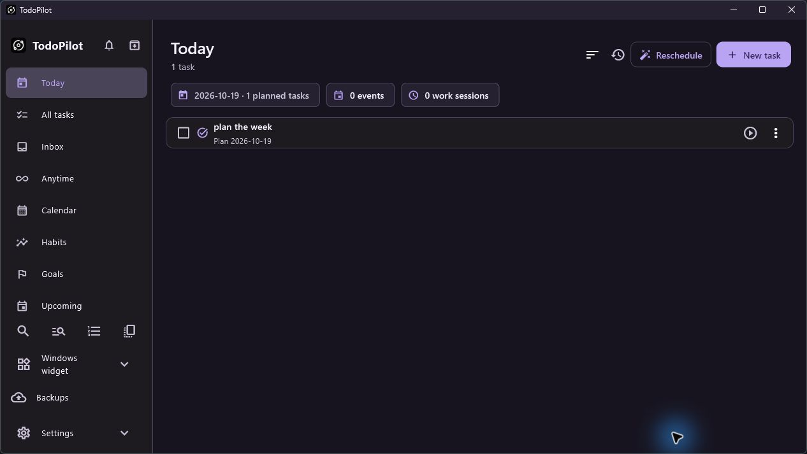

# TodoPilot




TodoPilot is an offline Windows productivity app for tasks, calendar events, habits, goals, focus sessions, and a native desktop widget. It is built with Flutter and SQLite. Creator: [Hussam Alkhatib](https://2hik4.github.io/).

## What it does

- Plan tasks and deadlines separately; track actual work with focus timers and sessions.
- Organize categories, projects, subtasks, recurring tasks, and saved views.
- View fixed events and tasks on the calendar; preview Smart Reschedule before applying it.
- Track habits and goals, and review reports.
- Use a native Windows desktop widget for Quick Add, task editing, and completion.
- Keep data local, with managed backups, reviewed restore, and SQLite import/export.
- Customize light and dark color palettes with a color wheel and share validated JSON themes through Settings → Appearance → Customize Theme.

## Windows installation

The current target is Windows x64. Windows 11 is the tested development environment; Windows 10 and other configurations need acceptance testing. Use the installer or extract the portable ZIP and run `TodoPilot.exe`. Keep the full extracted folder together, including `TodoPilotWidget.exe`, DLLs, and the `data` folder. Neither package requires Flutter or Visual Studio on the user's computer.

The portable ZIP does **not** store data beside the executable. TodoPilot continues to use `%APPDATA%\Life Manager\life_manager.sqlite` so existing Life Manager data and backups remain available after the rename. A database below the current schema requires explicit approval and a verified Before upgrade backup. Back up data before upgrading; do not move or delete that folder to rename the app.

The native widget can be shown from the app sidebar. Right-click it for Refresh, appearance, layout lock, and Close Widget. The widget can run while the main window is closed. The optional PIN locks the UI; it does not encrypt the SQLite database.

## Source build

Install Flutter with Windows desktop support, Visual Studio C++ desktop tools, and .NET 10 SDK. Then run:

```powershell
flutter pub get
flutter analyze
flutter test
flutter build windows --release
```

The Release bundle is `build\windows\x64\runner\Release`. Build instructions and architecture are in [docs/DEVELOPMENT.md](docs/DEVELOPMENT.md).

## Customization and contributions

See [theming](docs/THEMING.md), [customization extension points](docs/CUSTOMIZATION.md), and [contribution guidance](CONTRIBUTING.md). Official community entries come from `assets/contributors.json` through reviewed pull requests; imported themes do not add someone to that list.

Creator: **Hussam Alkhatib**, Creator & Project Founder. Original concept, product direction, and development of TodoPilot. [Email](mailto:hussamalkhatib24@gmail.com) · [Portfolio](https://2hik4.github.io/) · [LinkedIn](https://www.linkedin.com/in/hussam-alkhatib-dev).

## Current release status

The source and packages are being prepared for an open-source release. Native widget alpha blending, Win+D, different wallpapers and monitor layouts, installer upgrade/uninstall, and complete Windows GUI flows still require manual acceptance. The installer is unsigned. See [release preparation](docs/RELEASE.md) and [acceptance matrix](docs/ACCEPTANCE.md).

**License:** MIT is proposed in [LICENSE.proposed](LICENSE.proposed) for creator review. No public publication or license grant is implied until it is approved. Flutter and package notices are bundled in the generated `data\flutter_assets\NOTICES.Z`.
