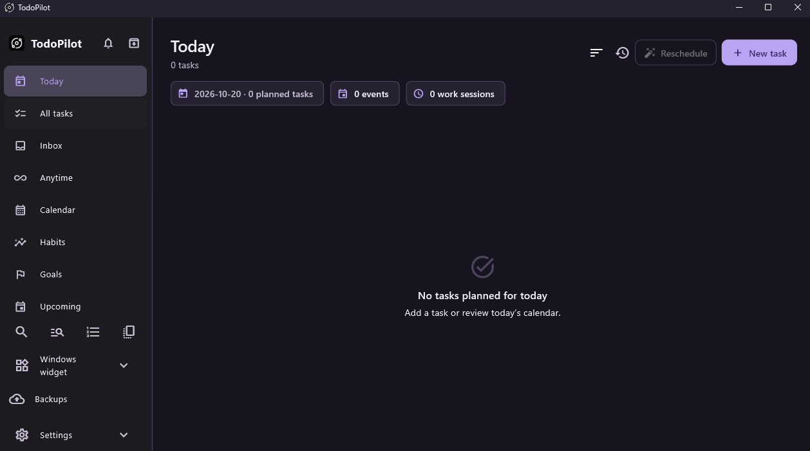

# Todorbit

**A free, local-first planner for Windows and Android.**

[Download Todorbit](https://github.com/2HIK4/Todorbit/releases) · [Installation guide](docs/INSTALLATION.md) · [Project website](https://2hik4.github.io/Todorbit/) · [Contributing](CONTRIBUTING.md)

Todorbit brings tasks, projects, calendar events, habits, goals, and focus
sessions into one place. It helps you plan for a deadline, set aside time for
the work, and record what you actually did. It is built with Flutter and
SQLite and works offline without a Todorbit account or subscription.

*Windows Today view from Todorbit v1.0.12.*

## What you can do

- Organize work with projects, categories, subtasks, recurring tasks, search,
  and saved views.
- See fixed events alongside planned tasks and sessions. Preview a Smart
  Reschedule proposal and choose whether to apply it.
- Track habits and goals, run focus timers, log actual work, and review reports.
- Keep tasks or your calendar visible through Windows desktop widgets or
  Android home-screen widgets.
- Personalize light and dark palettes and share validated theme JSON.
  Windows includes additional desktop widget customization.

See the [platform support matrix](docs/PLATFORM_SUPPORT.md) for platform differences
and features that are still experimental.

## Install

Downloads are available as **experimental pre-releases** on
[GitHub Releases](https://github.com/2HIK4/Todorbit/releases). Review the
release notes, verify the published SHA-256 for your file, and keep an
independent backup before upgrading.

| Platform | Package |
| --- | --- |
| Windows x64 | Unsigned installer or portable ZIP. Windows 11 is the primary test platform. Windows 10 acceptance is limited. |
| Android 8.0+ | Production-signed GitHub APK for ARM64 and x86-64 devices. |

The [installation guide](docs/INSTALLATION.md) covers checksums, Android
signing, and how to move a portable Windows copy while keeping access to your
data.

## Your data

Todorbit keeps your planner in a local SQLite profile. You can create and
restore local snapshots, export a database, and transfer supported settings
separately. The optional app PIN hides the interface. Local databases and
local recovery copies remain unencrypted by Todorbit.

Google Drive features are optional and experimental.

- **Sync** exchanges portable edits across devices and lets you review
  conflicts. Standard Sync stores readable planner JSON in your account's
  hidden app-data folder. Private Encrypted Sync encrypts data before upload.
  Save the passphrase and recovery code when setting up a new private workspace.
  [Sync setup and recovery](docs/GOOGLE_DRIVE_SYNC.md)
- **Backups** create encrypted point-in-time snapshots on request. The backup
  passphrase is required to decrypt each snapshot. A full restore replaces the
  local database after review. [Backup contents and recovery](docs/GOOGLE_DRIVE_BACKUP.md)

Managed attachments are included in snapshots and can sync. The contents of
linked external files stay on the original device. See the
[privacy disclosure](docs/PRIVACY.md) for account permissions, device-local
credentials, and deletion.

## Build, customize, and contribute

Start with the [contributor guide](CONTRIBUTING.md) and
[development setup](docs/DEVELOPMENT.md) for Windows or Android. The
[architecture map](docs/ARCHITECTURE_MAP.md) points to the source and tests for
each feature. Use an isolated profile when running source builds.

- [Theming](docs/THEMING.md) and [customization extension points](docs/CUSTOMIZATION.md)
- [Roadmap](docs/ROADMAP.md) and [release notes](https://github.com/2HIK4/Todorbit/releases)
- [Bug reports and feature requests](https://github.com/2HIK4/Todorbit/issues) and
  [private security reporting](SECURITY.md)

Created by **Hussam Alkhatib**, Creator & Project Founder.
[Email](mailto:hussamalkhatib24@gmail.com) · [Portfolio](https://2hik4.github.io/) ·
[LinkedIn](https://www.linkedin.com/in/hussam-alkhatib-dev)

**License:** [MIT](LICENSE). See [third-party notices](THIRD_PARTY_NOTICES.md)
and the [official contributor registry](assets/contributors.json).

You can support independent development with an optional
[PayPal donation](https://paypal.me/2hussam4). All features remain free.
