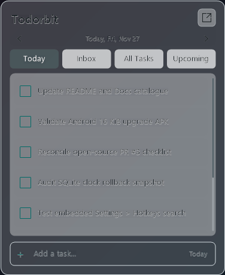
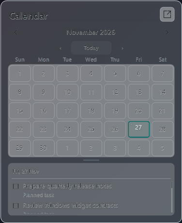

# Todorbit

[Official Website](https://2hik4.github.io/Todorbit/) · [Feature Catalogue (54 Capabilities)](docs/FEATURES.md) · [Architecture](docs/ARCHITECTURE.md) · Architecture Map (`docs/ARCHITECTURE_MAP.md` on `feature/todorbit-beta27-refinement`) · [Open-Source Evidence](docs/OPEN_SOURCE_EVIDENCE.md) · [Contributing](CONTRIBUTING.md)


> **Your day, in your orbit.** A free, open-source, local-first productivity planner for **Windows** and **Android** built with **Flutter**, **Drift/SQLite**, native **Kotlin**, and a **.NET 10 Windows companion**.

Todorbit keeps your **planned date**, **deadline**, **fixed calendar events**, **habits**, **goals**, and **actual recorded work sessions** clearly separated inside a local SQLite database—without mandatory cloud accounts, telemetry, or subscriptions.

---

## Visual Overview (Synthetic Isolated Profiles)

| Windows Desktop Workspace (`Today`) | Android Today View |
| --- | --- |
|  |  |
| *Live `Todorbit.exe` isolated runtime capture (`Graphite Neutral Silver` dark palette).* | *Offscreen synthetic mobile render (`390×844` dark theme).* |

| Interactive Calendar (`Week` Grid) | Embedded Settings > Hotkeys (Beta 30 Candidate) |
| --- | --- |
|  |  |
| *Live `Todorbit.exe` runtime capture showing Day/Week/Month, zoom/undo toolbar, and tasks alongside events.* | *Live `Todorbit.exe` runtime capture of the embedded Hotkeys editor, preset selector, and shortcut filter.* |

| Native Windows Tasks Widget (Offscreen Light/Dark-Wallpaper Render) | Native Windows Calendar Widget (Offscreen Light/Dark-Wallpaper Render) |
| --- | --- |
|  |  |
| *Beta 30 candidate `.NET 10` Explorer widget render (`capture-matrix`) with translucent Light palette & directional contrast lift.* | *Beta 30 candidate `.NET 10` Calendar widget render (`capture-matrix`) showing Month dot grid & scrollable Agenda.* |

---

## Key Capabilities

Every implemented user-facing capability (`54` verified features across `15` areas, plus transparent platform status and limitations) is inventoried in **[docs/FEATURES.md](docs/FEATURES.md)**:

1. **Task Planning, Structure & Views**: Separate `scheduledDate` and `deadlineDate`, categories, two-level projects, one-level subtasks, named checklist groups, dependency sequences, progressive recurring step plans, reusable templates, recoverable Archive & Trash, `Saved Views`, `Quick Search` (`Ctrl+K`) covering tasks & events, and multi-criteria `Advanced Search`.
2. **Interactive Calendar & Smart Reschedule**: Day/Week/Month desktop grid (`CalendarView`) with cursor-anchored zoom, drag/edge resize, and undo (`Ctrl+Z`); touch Android agenda (`MobileCalendar`); deterministic `SmartRescheduleDialog` supporting `move`, `shift`, `push`, `pull`, `swap`, `reorder`, `repack`, `split`, and undo with mandatory preview before committing (Calendar guide (`docs/INTERACTIVE_CALENDAR.md` on `feature/todorbit-beta27-refinement`)).
3. **Focus Timers, Habits, Goals & Reports**: Stopwatch, Countdown, and Pomodoro `FocusWorkspace` + floating mini timer; manual and tracked work logs with multi-device timer ownership handoff; binary/minimum/maximum habits & streaks; milestones & linked goals; and local `ReportsView` up to 366 days.
4. **Native Desktop & Mobile Widgets**:
   - **Windows (`TodorbitWidget.exe`)**: Explorer-hosted Tasks and Calendar widgets with inline Quick Add, compact editor, real-time Settings preview IPC, smooth continuous pixel scrolling honoring OS wheel & reduced-motion preferences, and Light/Dark/Custom palette transparency ([Windows widget guide](docs/windows-widget.md)).
   - **Android (`RemoteViews`)**: Home-screen Tasks & Calendar widgets with dark/light theme matching and PIN-safe completion routing (Android guide (`docs/ANDROID.md` on `feature/todorbit-beta27-refinement`)).
5. **Local-First Data Safety, Backups & Portability**: Schema v29 SQLite with optimistic CAS revision tokens and atomic multi-table transactions; verified local `VACUUM INTO` snapshots with automatic *Before Restore* recovery copies; portable profile isolation; and selective JSON `SettingsTransfer`.
6. **Optional Google Drive Backup & Incremental Sync (Experimental)**: Least-privilege `drive.appdata` scope only; client-side **AES-256-GCM + PBKDF2** encrypted full/settings snapshots (`70 MiB` package ceiling); causal `SyncEngine` protocol v2 with **Standard Sync** (readable JSON default) and **Private Encrypted Sync** (Argon2id passphrase wrapper + recovery code), conflict review, and bounded background exchange ([Privacy](docs/PRIVACY.md) · Sync guide (`docs/GOOGLE_DRIVE_SYNC.md` on `feature/todorbit-beta27-refinement`) · [Backup guide](docs/GOOGLE_DRIVE_BACKUP.md)).
7. **Customization & Embedded Hotkeys**: Default `Graphite Neutral Silver` dark palette plus curated presets (`Graphite Violet`, `Amber`, `Sage`, `Beta 27 Teal`, `Dusk`, and `Light`), custom WCAG-checked color picker, non-executable `v1` JSON themes ([Theming](docs/THEMING.md)), inline spell highlighting, and an embedded **Settings > Hotkeys** editor with preset management (Beta 30 candidate).
8. **Resources, Alarms & In-App Updates**: Managed in-SQLite SHA-256 attachments, external paths/URLs, Android share-sheet `SharedInboxScreen`, native scheduled alarms & lock-screen privacy redaction, and SHA-256 / AOSP `ApkVerifier`-verified in-app updates ([Android updates](docs/ANDROID_UPDATES.md)).

---

## Architecture & Engineering Principles

Todorbit enforces a strict 4-tier architecture validated automatically on CI by `python tools/test_architecture_boundaries.py`:

```text
  Presentation (lib/features/)          ── Windows Workspace, SettingsHub, MobileWorkspace
        │
        ▼
  Orchestration (lib/app/)              ── AppController (Riverpod), SyncController, PrivacyManager
        │
        ├──────────────────────────────┐
        ▼                              ▼
  Pure Domain (lib/domain/)      Persistence & Cloud (lib/data/)
  Schedules, recurrence, sync     Drift SQLite (v29), CAS, Backups,
  merges, palettes, hotkeys       Drive Sync & Update downloader
                                       │
        ┌──────────────────────────────┴──────────────────────────────┐
        ▼                                                             ▼
  Windows Native (experiments/widget-shell-probe/, windows/)   Android Native (android/.../todorbit/)
  .NET 10 Explorer widgets, Alarms, IPC, Win32 channels        Kotlin RemoteViews, AlarmDelivery, WorkManager
```

- **Domain Purity**: `lib/domain/` stays pure Dart free of Flutter/persistence imports (aside from audited keyboard/color data adaptors).
- **Transaction & CAS Encapsulation**: Presentation never invokes raw SQLite handles or `db.transaction`; companion processes and background workers coordinate via SQLite leases and CAS timestamps.
- **No Telemetry / No Tracking**: Zero analytics SDKs, zero third-party ad/crash telemetry, and platform-protected storage (`DPAPI` on Windows, `EncryptedSharedPreferences` / Android Keystore patterns) for optional OAuth/keys.

Deep dives: [Architecture](docs/ARCHITECTURE.md) · Architecture Map (`docs/ARCHITECTURE_MAP.md` on `feature/todorbit-beta27-refinement`) · UI Design System (`docs/UI_DESIGN_SYSTEM.md` on `feature/todorbit-beta27-refinement`) · [Open-Source Readiness & PR #3 Reconciliation](docs/OPEN_SOURCE_READINESS.md).

---

## Current Release & Verification Status

| Channel / Line | Version / Commit | SQLite / Sync | Notes |
| --- | --- | --- | --- |
| **Latest Public Prerelease** | [`v1.0.19-beta.30`](https://github.com/2HIK4/Todorbit/releases/tag/v1.0.19-beta.30) (`253f4ed`) | Schema `29` / Protocol `2` | Windows x64 installer (`setup.exe`), portable ZIP, and production-signed Android APKs (`universal`, `arm64`, `x86-64`) with desktop widget contrast/pixel-scroll fixes, embedded **Settings > Hotkeys**, and PR #3 hardening. |
| **Development Branch (`HEAD`)** | `feature/todorbit-beta27-refinement` (`1.0.19-beta.30+53` line) | Schema `29` / Protocol `2` | Active Experimental release and stabilization branch (`Stable` remains separate). |
| **Public Default (`main`)** | Protected release/website anchor | — | Documentation & website updates target `main` cleanly without modifying Stable binaries or merging experimental app code. |

- **Disclosures**: Windows binaries are unsigned (Windows 11 primary; Windows 10 limited). Google Drive OAuth branding verification and broad public compliance remain unresolved (disabled by default in source builds until OAuth parameters are supplied). Trademark review remains open ([docs/NAMING_REVIEW.md](docs/NAMING_REVIEW.md)).
- **Verifiable Public Snapshot**: Metrics, CI workflow links (`Windows checks`, `Android validation`, and `16 KiB PAGE_SIZE=16384` upgrade check), and download counts without fabrication are tracked in [docs/OPEN_SOURCE_EVIDENCE.md](docs/OPEN_SOURCE_EVIDENCE.md).

---

## Installation

### Windows (x64)

1. Download the installer or portable ZIP from [`v1.0.19-beta.30`](https://github.com/2HIK4/Todorbit/releases/tag/v1.0.19-beta.30) and compare the `Todorbit-1.0.19-beta.30-SHA256SUMS.txt` checksum.
2. Run the installer, or extract the **entire** portable ZIP (`Todorbit.exe`, `TodorbitWidget.exe`, DLLs, `data/`) and launch `Todorbit.exe`.
3. **Profile isolation**: Portable folders use `%APPDATA%\TodoPilot\portable-<location-id>`; moving the folder picks a different profile, so export a backup from **Settings > Backups & Cloud** first. See [docs/INSTALLATION.md](docs/INSTALLATION.md).

### Android 8.0+ (Beta)

1. Download `Todorbit-1.0.19-beta.30-android-universal.apk` (or architecture-specific `arm64`/`x64`) and verify `ANDROID-SHA256SUMS.txt`.
2. Existing production-signed installs can check **Settings > Software Updates** (Pre-release channel) for native signature-verified in-app updates (docs/ANDROID_UPDATES.md (`docs/ANDROID_UPDATES.md` on `feature/todorbit-beta27-refinement`)).

---

## Building, Testing & TDAT (`.\dev`)

### Prerequisites

- **Flutter** `3.47.7` (Dart `3.13.5`) with Windows desktop enabled
- **Visual Studio 2022** (Desktop development with C++)
- **.NET 10 SDK** (for `experiments/widget-shell-probe/`)
- **JDK 21 & Android SDK** (API 36, optional for Android builds; see docs/ANDROID_SETUP.md (`docs/ANDROID_SETUP.md` on `feature/todorbit-beta27-refinement`))

### Quick Contributor Setup

```powershell
# 1. Restore dependencies cleanly
flutter.bat pub get --enforce-lockfile

# 2. If Windows Developer Mode symlinks are restricted locally:
powershell -ExecutionPolicy Bypass -File tools/dev/prepare-windows-plugins.ps1

# 3. Verify toolchain, worktree paths, RAM/disk, and plugin links
.\dev doctor

# 4. Run architecture boundary checks and documentation verification
python tools/test_architecture_boundaries.py
python tools/dev/check-docs.py
python -m unittest discover -s tools -p "test_*.py"

# 5. Build and run native Windows widget companion self-tests & benchmark
dotnet build experiments/widget-shell-probe/widget-shell-probe.csproj -c Release
.\experiments\widget-shell-probe\bin\Release\net10.0-windows\TodorbitWidget.exe --self-test
.\experiments\widget-shell-probe\bin\Release\net10.0-windows\TodorbitWidget.exe --lifecycle-self-test
.\experiments\widget-shell-probe\bin\Release\net10.0-windows\TodorbitWidget.exe --scroll-benchmark

# 6. Run isolated Windows Flutter tests / offscreen screenshot lab / live driver verification
.\dev verify changed
.\dev screenshot all
.\dev runtime windows -LiveApp -BuildLiveApp
```

Explore Developer Automation Toolkit (`docs/DEVELOPER_AUTOMATION_TOOLKIT.md` on `feature/todorbit-beta27-refinement`), [Testing](docs/TESTING.md), and [Development](docs/DEVELOPMENT.md).

---

## Roadmap & Contributing

Active development tracks accessibility & multi-monitor/physical-device acceptance gates (docs/DEFERRED_VERIFICATION.md (`docs/DEFERRED_VERIFICATION.md` on `feature/todorbit-beta27-refinement`)), Beta 30 widget/Hotkeys stabilization ([CHANGELOG.md](CHANGELOG.md)), and newcomer-friendly engineering tasks ([docs/CONTRIBUTOR_TASKS.md](docs/CONTRIBUTOR_TASKS.md) · [docs/ROADMAP.md](docs/ROADMAP.md)).

- **How to contribute**: Start with [CONTRIBUTING.md](CONTRIBUTING.md) and our [Code of Conduct](CODE_OF_CONDUCT.md).
- **Security vulnerabilities**: Do **not** file public issues for exploits, credentials, or private backups; follow [SECURITY.md](SECURITY.md).
- **Creator**: [Hussam Alkhatib](https://2hik4.github.io/) ([Email](mailto:hussamalkhatib24@gmail.com) · [LinkedIn](https://www.linkedin.com/in/hussam-alkhatib-dev)). Community attributions live in `assets/contributors.json`.
- **License**: [MIT](LICENSE). Third-party attributions: [THIRD_PARTY_NOTICES.md](THIRD_PARTY_NOTICES.md).
