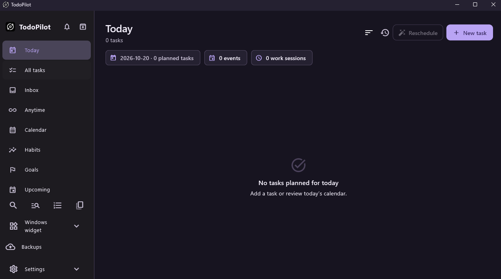

# Todorbit

[Official website](https://2hik4.github.io/Todorbit/) · [Privacy Policy](https://2hik4.github.io/Todorbit/privacy.html) · [Terms of Service](https://2hik4.github.io/Todorbit/terms.html)




Todorbit is an offline Windows productivity app for tasks, calendar events, habits, goals, focus sessions, and a native desktop widget. It is built with Flutter and SQLite. Creator: [Hussam Alkhatib](https://2hik4.github.io/).

## What it does

- Plan tasks and deadlines separately; track actual work with focus timers and sessions.
- Organize categories, projects, subtasks, recurring tasks, and saved views.
- View fixed events and tasks on the calendar; preview Smart Reschedule before applying it.
- Track habits and goals, and review reports.
- Use a native Windows desktop widget for Quick Add, task editing, and completion.
- Keep data local, with managed backups, reviewed restore, and SQLite import/export.
- Customize light and dark color palettes with a color wheel and share validated JSON themes through Settings → Appearance → Customize Theme.

## Windows installation

Todorbit v1.0.16 is a free, MIT-licensed Windows x64 pre-release. Windows 11 is the main development and test platform; Windows 10 acceptance is limited. Download the unsigned installer or portable ZIP from [GitHub Releases](https://github.com/2HIK4/Todorbit/releases/tag/v1.0.16) and compare it with the published SHA-256 checksum. Run the installer or extract the portable ZIP and run `Todorbit.exe`. Keep the full extracted folder together, including `TodorbitWidget.exe`, DLLs, and the `data` folder. Neither package requires Flutter or Visual Studio on the user's computer.

The portable ZIP does **not** store data beside the executable. Each extracted portable location uses its own `%APPDATA%\TodoPilot\portable-<location-id>` profile; copying or moving the extracted folder selects a new empty profile. An installer fresh profile uses `%APPDATA%\TodoPilot\life_manager.sqlite`. This legacy path remains stable through the rename. An older `%APPDATA%\Life Manager` database is never selected just because it exists; on first launch Todorbit offers a reviewed, explicit import. Upgrading an installed TodoPilot retains its existing profile and settings. Export/import data through Settings > Backups & Cloud before moving a portable folder, and do not delete either profile folder.

Google Drive encrypted backup/restore is **enabled and experimental since v1.0.13**, with real full/settings recovery verification. The published packages bundle the tested Desktop application configuration; users do not need Google Cloud setup or a credentials JSON. Google branding verification and full public OAuth policy compliance remain unresolved; no Google approval or compatibility with every account is claimed. This is snapshot backup/restore, not automatic synchronization; linked external file contents are excluded. Local backups and settings JSON transfer remain available offline. Source builds keep a disabled/empty default configuration. See [backup contents and recovery](docs/GOOGLE_DRIVE_BACKUP.md), [publication evidence and limitations](docs/TODORBIT_1_0_16_PUBLICATION.md), and the [privacy disclosure](docs/PRIVACY.md).

The native widget can be shown from the app sidebar. By default, it launches at Windows sign-in after Todorbit's first launch; Settings > Widget can turn this off. Right-click it for Refresh, appearance, layout lock, and Close Widget. The widget can run while the main window is closed. The optional PIN locks the UI; it does not encrypt the SQLite database. See [installation and portable upgrade instructions](docs/INSTALLATION.md).

## Source build

Install Flutter with Windows desktop support, Visual Studio C++ desktop tools, and .NET 10 SDK. Then run:

```powershell
flutter pub get
flutter analyze
flutter test
./tools/build-windows-release.ps1
```

The Release bundle is `build\windows\x64\runner\Release`. See [Development](docs/DEVELOPMENT.md) for toolchain/profile setup, [Architecture](docs/ARCHITECTURE.md) for subsystem locations, and [Testing](docs/TESTING.md) for focused checks during development. The commands above are a full source-build baseline.

If a moved portable copy looks empty, check Settings > Data profile and reopen the original extracted path or import its verified backup. Keep the full application bundle together. See [installation troubleshooting](docs/INSTALLATION.md) for recovery steps.

## Customization and contributions

See [theming](docs/THEMING.md), [customization extension points](docs/CUSTOMIZATION.md), and [contribution guidance](CONTRIBUTING.md). Official community entries come from `assets/contributors.json` through reviewed pull requests; imported themes do not add someone to that list.

Creator: **Hussam Alkhatib**, Creator & Project Founder. Original concept, product direction, and development of Todorbit. [Email](mailto:hussamalkhatib24@gmail.com) · [Portfolio](https://2hik4.github.io/) · [LinkedIn](https://www.linkedin.com/in/hussam-alkhatib-dev).

## Current release status

The v1.0.16 pre-release refines the independent Tasks and Calendar widgets, adds a scrollable Calendar agenda and edge alignment, and includes optional support for Todorbit. Google Drive snapshots remain experimental. Schema 20 profiles still require approval and a verified backup before migration to schema 21. Clean Windows-user/VM testing was explicitly skipped; registered installer upgrade/uninstall, physical GUI/input/DPI and clean-machine trust remain unverified. Packages are unsigned. See [release notes](docs/TODORBIT_1_0_16_RELEASE_NOTES.md), [acceptance matrix](docs/ACCEPTANCE.md), and the [preliminary naming review](docs/NAMING_REVIEW.md); formal trademark clearance remains open.

**License:** [MIT](LICENSE), approved by the creator for this project. Third-party terms remain separate in [THIRD_PARTY_NOTICES.md](THIRD_PARTY_NOTICES.md) and the distributed Flutter and native notices.
