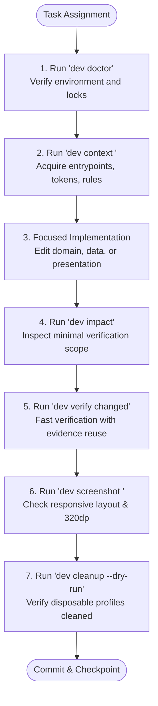

# Todorbit Developer Automation Toolkit (TDAT) & AI Engineering Harness

## 1. Overview & Mission

The **Todorbit Developer Automation Toolkit (TDAT)** and **AI Engineering Harness** provides a unified, maintainable, automation-first engineering environment for Todorbit desktop (Windows 10/11) and mobile (Android) development.

### Core Objectives:
- **Token and Context Efficiency:** Eliminate repetitive multi-turn file searches and manual architecture inquiries by generating deterministic AI feature context packs (`dev context <feature>`) and compact topology maps (`dev repomap`).
- **Conservative Impact Analysis:** Select the minimum sufficient verification scope (`Quick`, `Changed`, `Feature`, `Platform`, `Full`, `Release`) based on actual Git diffs, Dart import dependencies, critical schema gates, and shared UI boundaries.
- **Evidence-Backed Verification Reuse:** Fast 4-fingerprint caching (source hash, test hash, dependency lockfile, toolchain hash) returns instant `REUSED` receipts on unchanged files, drastically cutting verification time and machine cycles.
- **Automated Quality & Reliability Labs:** Deterministic synthetic workspace generation (`dev fixture <name>`) and headless offscreen layout verification (`dev screenshot <scenario>`) catch layout overflows and data errors before release.
- **Process Invocation Safety:** Strictly non-interactive process execution with explicit `.bat` and `.exe` resolution, preventing Windows OpenWith dialog triggers and hanging processes.
- **Repository Isolation:** Concurrently protect isolated worktrees (such as Codex release preparation on `feature/todorbit-ui-redesign-2`) from conflicting background processes and unauthorized changes.

---

## 2. Quick Start & CLI Entry Points

TDAT provides seamless cross-shell entry points:
- Windows Command Prompt: `dev <command> [options]`
- PowerShell: `.\dev <command> [options]` or `tools\dev\dev.ps1 <command> [options]`

### Common Commands:
```powershell
# Environment and health check
dev doctor

# Current repository, worktree, and host resource status
dev status

# Generate AI feature context pack before implementing changes
dev context calendar

# Generate compact repository topology map
dev repomap

# Analyze modified files and run minimal required verification
dev verify changed

# Run verification mapped to a specific feature
dev verify feature sync

# Generate deterministic synthetic fixture
dev fixture typical

# Run offscreen UI layout render and capture screenshot
dev screenshot workspace-desktop-1080p

# Verify Windows x64 PE binaries and package integrity
dev package

# Execute toolkit efficiency benchmarks
dev benchmark toolkit

# Run comprehensive toolkit self-tests
dev self-test
```

---

## 3. CLI Command Reference

| Command | Subcommand / Options | Description |
| :--- | :--- | :--- |
| `dev help` | | Displays discoverable command help and syntax examples. |
| `dev doctor` | `[--repair] [--json]` | Audits Flutter 3.47.7, Dart 3.13.5, MSVC Community 2022, Windows 10 SDK, Android SDK, JDK 21, RAM/disk limits, lock contention, and runs safe repair (e.g. plugin junctions). |
| `dev status` | `[--json]` | Displays active Git branch, commit, dirty status, free RAM, free disk, and active session ID. |
| `dev context` | `<feature> [--json]` | Generates concise, deterministic feature context pack (summary, requirements, entry points, architecture boundaries, design tokens, tests, invariants, skills, fixtures). |
| `dev repomap` | `[--json]` | Generates compact repository topology map and layer summary without vector indexing or hallucinations. |
| `dev impact` | `[--json]` | Inspects staged/unstaged changes, resolves dependencies, and computes conservative test selection. |
| `dev verify` | `quick -ChangedPaths .. -Tests ..` | Executes fast Level 1 verification on explicitly specified files. |
| `dev verify` | `changed` | Automatically detects changes, analyzes impact, reuses valid evidence, and runs required checks. |
| `dev verify` | `feature <name>` | Runs all automated tests mapped to the named feature in `features.json`. |
| `dev verify` | `platform <Windows\|Android\|All>` | Runs platform-scoped checks and platform channel verification. |
| `dev verify` | `full` | Executes full repository verification (analyze, unit/widget suites, architecture boundaries, docs). |
| `dev verify` | `release` | Runs mandatory release acceptance checks (Levels 1-4). |
| `dev fixture` | `<name> [--json]` | Generates deterministic synthetic SQLite database (`empty`, `small`, `typical`, `large`, `calendar-stress`, `sync-conflict`, `migration`). |
| `dev screenshot`| `<scenario> [--json]` | Renders headless offscreen Flutter viewports, verifies zero RenderFlex overflows, and exports PNG screenshots. |
| `dev package` | `[Windows\|Android\|All] [--json]`| Audits release artifacts: 64-bit x64 PE headers, CRT DLL imports, Inno Setup script, and Android 16 KiB ELF alignment. |
| `dev diagnose`| `last [--json]` | Extracts structured failure diagnostics, stack traces, and reproduction commands from the last test run. |
| `dev reproduce`| `<failure-id>` | Outputs self-contained command to reproduce a recorded failure. |
| `dev benchmark`| `<startup\|calendar\|search\|toolkit\|all>` | Measures cold/warm startup, memory consumption, calendar render latency, or toolkit hashing efficiency. |
| `dev cleanup` | `[--dry-run] [--force]` | Cleans old logs, ephemeral test profiles, and lock files with path-traversal and junction protection. |
| `dev registry`| `[--validate\|--refresh]` | Indexes repository tests into `registry.json` and verifies consistency. |
| `dev self-test`| | Runs comprehensive 11-point toolkit self-test suite. |

---

## 4. Toolkit Architecture & Modules

The toolkit is organized into modular PowerShell and Python components under `tools/dev/`:

```
tools/dev/
  ├── dev.ps1                   # Unified CLI entrypoint and command router
  ├── features.json             # Feature-to-file and feature-to-test mapping
  ├── feature_contexts.json     # Curated AI feature context packs (20 features)
  ├── registry.json             # Centralized test registry (234 test suites)
  ├── generate_fixture.py       # Deterministic SQLite fixture generator
  ├── check-docs.py             # Documentation link and cross-reference validator
  ├── test_toolkit_self.ps1     # 11-point automated self-test suite
  └── modules/
        ├── Doctor.psm1         # Environment audit, toolchain resolution, RAM/disk contention
        ├── Session.psm1        # Atomic file locks (.buildlog/locks/) and safe cleanup
        ├── Registry.psm1       # Automated test suite discovery, indexing, and validation
        ├── Impact.psm1         # Conservative impact analysis and dependency propagation
        ├── Evidence.psm1       # 4-fingerprint SHA-256 caching (.buildlog/evidence/)
        ├── Diagnostics.psm1    # Failure log extraction and reproduction generation
        ├── Harness.psm1        # Feature context pack and repository map generators
        ├── Fixtures.psm1       # Synthetic workspace generator wrapper
        ├── Lab.psm1            # Headless offscreen UI screenshot laboratory
        ├── Benchmarks.psm1     # Performance benchmarking and efficiency telemetry
        └── Reliability.psm1    # Release artifact auditing and fault-injection testing
```

---

## 5. Process Invocation Safety Policy

### Background & Defect Resolution
During automated tool execution on Windows, running `flutter` or `dart` without an explicit extension causes the Windows Shell to attempt to execute Unix bash shell scripts (`C:\VScode\flutter\bin\flutter`) located alongside Windows `.bat` files. Because Unix shell scripts lack a Windows file association, Windows displays a "How do you want to open this file? Pick an app" (`OpenWith.exe`) dialog in the taskbar.

### Invariants Enforced by TDAT:
1. **Explicit Executable Resolution:** All launchers and scripts must call `Resolve-TodorbitTool` in `Doctor.psm1`, resolving executables to explicit `.bat` or `.exe` paths:
   - Flutter: `C:\VScode\flutter\bin\flutter.bat`
   - Dart: `C:\VScode\flutter\bin\cache\dart-sdk\bin\dart.exe`
2. **Extensionless Execution Forbidden:** PowerShell or CMD commands must never invoke `flutter` or `dart` bare.
3. **Non-Interactive Execution:** PowerShell launchers (`dev.cmd`, `dev.ps1`, `verify.ps1`) pass `-NonInteractive` and `-NoProfile`.
4. **Native Argument Splatting:** Array arguments across PowerShell boundaries use hashtable splatting (`& $script @args`) instead of comma-joined strings.
5. **Toolchain Hash Caching:** `Get-ToolchainHash` caches the toolchain hash in memory for the duration of the session, eliminating repeated child-process `flutter --version` executions.
6. **Regression Protection:** Enforced continuously by `tools/test_process_invocation_safety.py` (5 automated checks verifying script contents, launcher parameters, toolchain resolution, and non-interactive flags).

---

## 6. Permanent Automation-First Workflow for AI Agents

All AI assistants (Gemini, Claude, Codex, Antigravity) working in the Todorbit repository must adhere to the following workflow:



1. **Start with Health Check:** Run `.\dev doctor` to verify toolchains, available RAM, and lack of conflicting lock files.
2. **Acquire Feature Context:** Never search the codebase blind. Run `.\dev context <feature>` to receive exact file paths, architectural rules, design system tokens, applicable AI skills, and historical invariants.
3. **Run Impact-Driven Verification:** Run `.\dev verify changed`. TDAT will automatically compute the affected features, check content-addressed evidence caches, reuse unchanged passes, and run only the necessary tests.
4. **Verify UI Responsiveness:** For UI/UX changes, run `.\dev screenshot <scenario>` to verify 1080p desktop, 320dp mobile, and 150% text scaling layouts without manual clicking.
5. **Add Regression Tests:** Every bug fix must include an automated regression test covering the failure mode.
6. **Register New Tests:** Run `.\dev registry refresh` to register new tests and `.\dev registry validate` to confirm 0 unregistered tests.
7. **Clean Ephemeral Artifacts:** Run `.\dev cleanup --dry-run` followed by `.\dev cleanup` to remove temporary build logs and disposable test profiles.

---

## 7. Diagnostics Playbook & Exit Codes

| Exit Code | Meaning | Action Required |
| :---: | :--- | :--- |
| `0` | Success | All checks, benchmarks, or verification tests passed. |
| `1` | Test / Verification Failure | Run `.\dev diagnose last` to extract the exact failure message, failed tests, and reproduction command. Run `.\dev reproduce` to reproduce locally. |
| `2` | Environment / Doctor Error | Run `.\dev doctor` to identify missing toolchains (Flutter, Dart, JDK 21, Android SDK) or low RAM. |
| `3` | Lock Contention / Session Busy | Another process holds `.buildlog/locks/todorbit.lock`. Inspect active processes or clean stale lock with `.\dev cleanup --force`. |

### Failure Reproduction Workflow:
```powershell
# 1. View failure diagnostics
dev diagnose last

# 2. View and copy reproduction command
dev reproduce

# 3. Fix code and re-verify
dev verify changed
```
