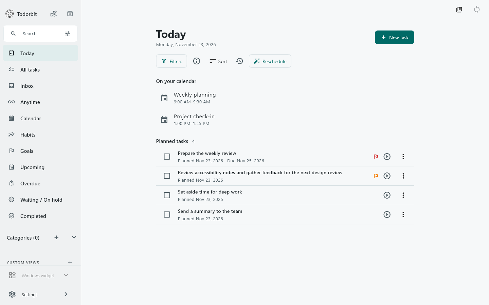
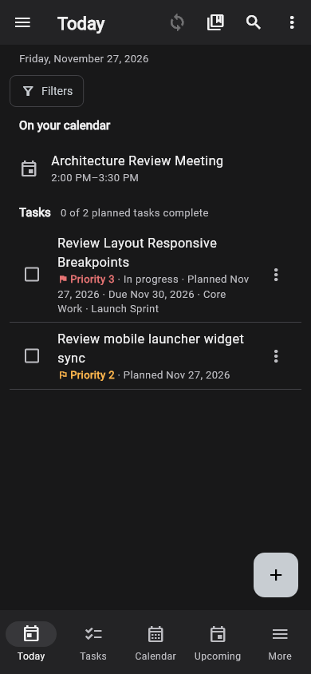
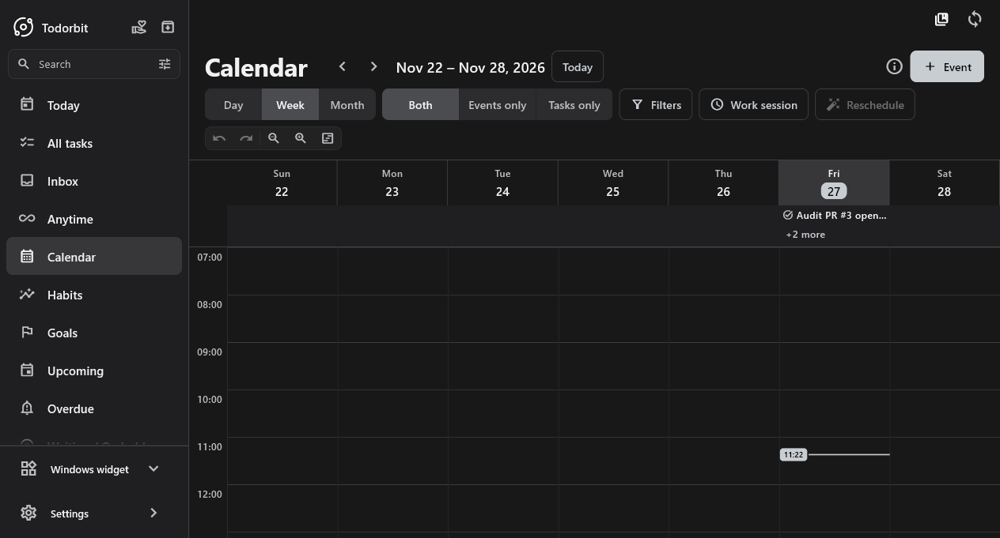
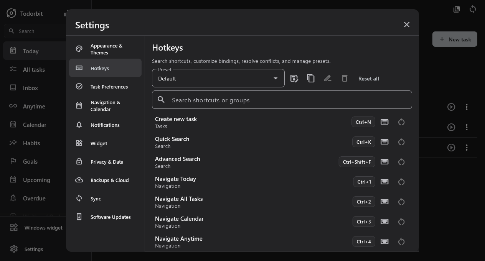
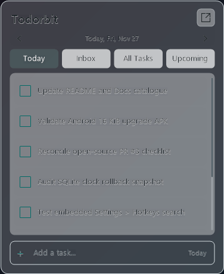
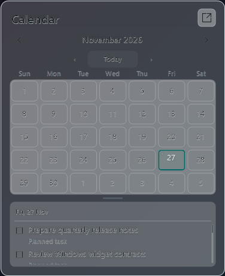

# Todorbit screenshots

These images use isolated profiles and fictional planner records. The labels describe how each image was captured. The images come from the Beta 30 development line and do not all have an exact tagged-build capture receipt.

## Today

Windows desktop runtime capture.

Android layout rendered offscreen at 390 × 844. Physical Android device behavior requires separate verification.

## Windows calendar and hotkeys

Windows Calendar runtime capture showing the week view and zoom and undo controls.

Windows Settings runtime capture showing the embedded Hotkeys editor shipped in Beta 30.

## Windows desktop widgets

Native Tasks and Calendar widget renders produced by the offscreen capture tool. Live Explorer attachment, wallpaper behavior, and physical DPI require their own checks.

[Back to Todorbit](../README.md) · [Platform support](PLATFORM_SUPPORT.md)
