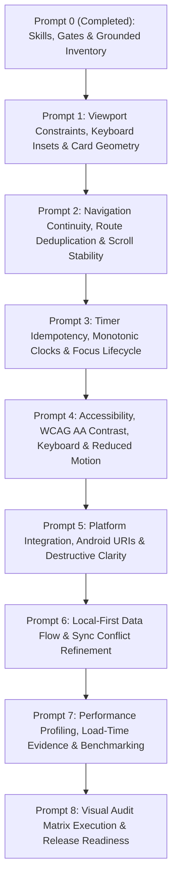

# Todorbit UI & Reliability Improvement Program

**Document Purpose**: Durable tracking, grounded issue inventory, and phased implementation roadmap for Todorbit's multi-stage UI and reliability improvement program across Windows 10/11 and Android.
**Baseline Checkpoint**: Beta 23 (`ec94f68`, Schema 29, 2026-11-17).
**Program Scope**: Prompts 0 through 8 covering UI responsiveness, viewport constraints, navigation continuity, timer idempotency, accessibility, platform integration, and verification hardening.

---

## Current checkpoint - Prompts 2/3 integrated (2026-11-17)

**Shared development base:** `integration/ui-reliability-p2-p3` in
`D:/AI_Projects/life_manager_worktrees/integration-ui-p2-p3`, from `5803e52`.
User-authorized isolated merges preserve Prompt 2 `9f7b3e3` followed by Prompt 3
`b3ee745`. This integration assignment supersedes the historical implementation
allocation/no-merge instructions below. Original and implementation checkouts
remain unchanged; no push, Stable change or publication.

Prompt 2 is task timers/details/checklists/subtasks/planned-session deletion;
Prompt 3 is calendar responsiveness/events/metadata/colors/month navigation.
Both are integrated and reviewed with **122 selected tests PASS / 0 FAIL / 0 SKIP**,
clean full analysis and focused formatting/diff checks. Integration repairs cover
exact month edges, coalesced controller loads, cache notification invalidation,
Side Panel preference authority and organization-dialog lifecycle. See
[receipt](INTEGRATION_P2_P3_2026_11_17.md) and [source manifest](INTEGRATION_P2_P3_2026_11_17_SOURCE.json).

**Ready for the next development stage as the shared base for Prompts 4/5.**
Neither has started. Physical/device/release acceptance remains in Deferred
Verification; old implementation receipts and issue-routing diagrams below are
historical evidence, not approval for publication or a new assignment.

## Historical implementation assignment — Prompt 2 (2026-11-17)

The user's current Prompt 2 is **task timers, details, checklists, subtasks and
planned session deletion**, on `feature/todorbit-task-ux` in the task worktree,
base `5803e52`. Codex owns this implementation. This overrides the older prompt
numbering and agent allocation below for this assignment. Calendar/navigation
work outside these task journeys belongs to the separate assignment. No merge,
rebase, push, beta publication, schema/version change or Stable modification.

Implementation and scoped evidence: [Prompt 2 receipt](PROMPT2_TASK_UX_2026_11_17.md).
The old section 8 is historical planning, not authorization for integration.

## 1. Executive Summary & Ground Rules

1. **Grounded Source Analysis**: Screenshots and user images are treated as visual reference clues and symptom reports, **never** as proof of a code-level root cause. Every code-level finding is anchored in verified source paths under `lib/`, `windows/`, or `android/`.
2. **Preserve Approved Architecture & Data Safety**:
   - SQLite Schema remains at **29** with monotonic forward migrations in `AppDatabase` and `MigrationGate`.
   - Zero Data Loss: Never drop tables, reset profile JSON, or discard user data as an error fallback.
   - Monotonic compare-and-swap (CAS) task revisions with advancing `updated_at` timestamps.
   - Preserves dual-platform distinction: Desktop (`Workspace` -> `CalendarView`) and Android (`MobileWorkspace` -> `MobileCalendar`).
   - Retain modular monolith direction established in [Modular Architecture Audit](TODORBIT_MODULAR_ARCHITECTURE_AUDIT.md).
3. **Ponytail & Untangle Principles Applied**:
   - **Ponytail Ladder**: YAGNI -> Codebase Reuse -> Stdlib/Flutter Built-in API -> Installed Dependency -> Minimal Working Diff. Strictly avoid redundant wrapper widgets and speculative abstractions.
   - **Untangle Decoupling**: Eliminate hidden links (duplicate logic, implicit conventions), needless links (internal leaks, volatile imports), and surplus (dead code). Treat one-off special cases as architecture signals rather than patching with more one-offs.
   - **Strict Safety Constraint**: No sweeping repository-wide refactoring in a single pass; never delete tests.
4. **Phased Multi-Stage Execution (Prompts 0–8)**:
   - **Prompt 0 (Completed)**: Agent skills, quality gates, and grounded issue inventory (documentation and skill updates only).
   - **Prompt 0.5 (Foundational Baseline)**: Viewport constraints, keyboard-inset / IME-aware dialogs, responsive breakpoint wrapping, and card geometry alignment across variants (committed in `a451000`).
   - **Prompt 1 (Authoritative Scope)**: Search UX token unification, progressive disclosure for advanced search, Android IME keyboard-inset form adaptation, and single-route task/event detail presentation (`sidePanel` default vs `fullPage` preference, with zero stale secondary editors).
   - **Prompt 2 (current authoritative assignment)**: Task timer entry/idempotency, task details, checklist groups/items, one-level subtasks and planned-session deletion. See the current assignment override above.
   - **Prompt 3 (authoritative delivered scope)**: Calendar responsiveness, event organization/color editing, exact month prefetch and navigation. Earlier issue-routing numbers below remain historical.
   - **Prompt 4**: Accessibility (WCAG AA contrast >=4.5:1), keyboard traversal (<kbd>Tab</kbd>), screen reader semantics, and reduced motion.
   - **Prompt 5**: Platform-specific integration: Android Content URI persistence and destructive action clarity.
   - **Prompt 6**: Local-First Data Flow & Sync conflict review presentation refinement.
   - **Prompt 7**: Performance profiling, load-time evidence, and memory benchmarking.
   - **Prompt 8**: Verification hardening, Reusable Visual Audit Matrix execution, and release gate readiness.

---

## 2. Individually Traceable Issue Inventory (Mapped to Prompts 1–8)

*Inventory Verification & Coverage*: The inventory comprises **29 total traceable issues** across three primary architectural surfaces:
- **Group 1: Surface A (Alarm Editor & Reminder Controls)**: 4 issues (`ISS-A01` through `ISS-A04`)
- **Group 2: Surface B (Calendar, Agenda & Date Navigation)**: 7 issues (`ISS-B01` through `ISS-B07`)
- **Group 3: Surface C (Task Details, Task Editor & Workspace Shell)**: 18 issues (`ISS-C01` through `ISS-C18`)

*Historical Count Correction*: The previous report informally stated "18 issues" because Surface C ended at `ISS-C18`. The verified count across all three groups is **29 traceable issues** (4 + 7 + 18 = 29), ensuring 100% coverage of all documented defect surfaces.

*Root Cause Protocol*: All suspected root causes are explicitly labelled **HYPOTHESIS** pending isolated test reproduction.

### Group 1: Surface A — Alarm Editor & Reminder Controls

| ID | Issue Description & Component | Platform Impact | Suspected Root Cause (HYPOTHESIS) | Reproduction Steps | Expected Behavior | Verification Criteria | Severity | Prompt | Status |
|---|---|---|---|---|---|---|---|---|---|
| **ISS-A01** | **Alarm Option Label Overflow**<br>`lib/features/shared/alarm_field.dart` | **Android**: High.<br>**Windows**: Med. | Menu item labels exceed horizontal constraints when text scale is 1.5×–2.0× or width is 320dp, causing horizontal clipping or ellipsis truncation of time values. | 1. Open task with alarm.<br>2. Set text scale to 2.0×.<br>3. Open alarm options dropdown. | Options wrap naturally or use responsive layout so all trigger times remain readable. | Widget test in `test/alarm_field_test.dart` at 320dp width with 2.0× text scale. | **P1** | **Prompt 1** | Implemented & Verified |
| **ISS-A02** | **Series vs Occurrence Alarm Copy Clarity**<br>`lib/features/shared/alarm_field.dart` | **Both**: Med. | Copy "All occurrences" misleadingly implied single-occurrence overrides would be erased. Needs explicit "Use as series alarm" wording. | 1. Open recurring event occurrence.<br>2. Edit alarm.<br>3. Inspect option text. | Copy explicitly reads "Use as series alarm" and notes that existing occurrence overrides are preserved. | String and semantics assertions in `test/alarm_field_test.dart`. | **P2** | **Prompt 4** | Open |
| **ISS-A03** | **Alarm Helper Text Contrast**<br>`lib/features/shared/alarm_field.dart`<br>`lib/app/app_theme.dart` | **Both**: Med. | Secondary helper text in light mode used low-opacity foreground falling below WCAG AA 4.5:1 contrast against surface. | 1. Switch to light theme.<br>2. Inspect alarm helper caption.<br>3. Measure contrast. | Contrast ratio >= 4.5:1 against light background using `onSurfaceVariant` token. | Color calculation assertion in `test/theme_customization_test.dart`. | **P2** | **Prompt 4** | Open |
| **ISS-A04** | **Alarm Menu Keyboard Focus Ring**<br>`lib/features/shared/alarm_field.dart` | **Windows**: High.<br>**Android**: Low. | Keyboard <kbd>Tab</kbd> traversal does not display a visible high-contrast focus ring around alarm dropdown trigger. | 1. Tab to AlarmField on desktop.<br>2. Observe visual focus indicator. | Clear, high-contrast Fluent focus outline conforms to desktop design tokens. | Widget focus test in `test/workspace_test.dart`. | **P2** | **Prompt 4** | Open |

### Group 2: Surface B — Calendar, Agenda & Date Navigation

| ID | Issue Description & Component | Platform Impact | Suspected Root Cause (HYPOTHESIS) | Reproduction Steps | Expected Behavior | Verification Criteria | Severity | Prompt | Status |
|---|---|---|---|---|---|---|---|---|---|
| **ISS-B01** | **Pinned Today Selection vs Dynamic Following**<br>`lib/features/mobile/mobile_calendar.dart`<br>`lib/features/calendar/calendar_view.dart` | **Both**: High. | Tapping Today cell stored a concrete date string, pinning calendar to that past date across midnight rollover or app resume. | 1. Tap Today.<br>2. Advance system date past midnight.<br>3. Reopen/resume app. | Calendar dynamically follows local current date unless deliberate past/future browsing is active; "Back to today" restores follow. | Time travel test in `test/mobile_calendar_date_following_test.dart`. | **P1** | **Prompt 2** | Open |
| **ISS-B02** | **Calendar Mode Switch & Title Word-Breaking**<br>`lib/features/mobile/mobile_calendar.dart` | **Android**: High.<br>**Windows**: Low. | At 320dp width or 2.0× text scaling, mode switch buttons and month title collide and break words awkwardly onto multiple lines. | 1. Set text scale to 2.0× on 320dp screen.<br>2. View MobileCalendar header. | Mode buttons wrap below the month title or stack vertically; title never breaks words mid-character. | Layout constraint test in `test/mobile_calendar_test.dart`. | **P1** | **Prompt 1** | Implemented & Verified |
| **ISS-B03** | **Calendar Empty State Contrast**<br>`lib/features/mobile/mobile_calendar.dart` | **Both**: Med. | Empty day guidance text in light mode measured ~1.32:1 contrast against surface background, making it illegible. | 1. Open empty day in light mode.<br>2. Inspect empty state label. | Empty guidance text uses `onSurfaceVariant` with contrast >= 4.5:1. | Contrast assertion test in `test/calendar_card_contrast_test.dart`. | **P2** | **Prompt 4** | Open |
| **ISS-B04** | **Local vs Global CardTheme Clipping**<br>`lib/app/app_theme.dart`<br>`lib/features/mobile/mobile_calendar.dart` | **Both**: Med. | Global `CardTheme(clipBehavior: Clip.antiAlias)` clipped popup menus and navigator overlays; removing it globally caused card corners to bleed. | 1. Open popup menu anchored inside a card.<br>2. Inspect corner antialiasing and overlay clipping. | Cards clip locally via `clipBehavior: Clip.antiAlias` where needed; global theme allows overlay expansion. | Overlay render test in `test/calendar_test.dart`. | **P2** | **Prompt 1** | Implemented & Verified |
| **ISS-B05** | **Calendar Agenda Card Geometry Stutter**<br>`lib/features/calendar/calendar_agenda_view.dart`<br>`lib/features/mobile/mobile_calendar.dart` | **Both**: Med. | Agenda items with subtasks/alarms jump vertically in height compared to simple items, causing visual stutter on scroll. | 1. View agenda with mixed events and tasks.<br>2. Scroll through list. | Cards share identical horizontal margins, baseline vertical padding, and aligned leading icon/checkbox targets. | Golden / geometry assertion test in `test/calendar_test.dart`. | **P2** | **Prompt 1** | Implemented & Verified |
| **ISS-B06** | **Multi-Day Event Move Duration Invariance**<br>`lib/features/calendar/calendar_interaction_controller.dart` | **Both**: High. | Move gesture clamped end-time to 23:59 of target day, truncating multi-day and overnight events from 48h down to remaining hours. | 1. Create a 48h event.<br>2. Drag event to another day.<br>3. Inspect persisted duration. | Event duration remains strictly invariant (`end = start + duration`); no truncation across midnight. | Regression test in `test/calendar_event_move_recurrence_test.dart`. | **P0** | **Prompt 2** | Open |
| **ISS-B07** | **Calendar Drag Auto-Scroll Cancellation Hygiene**<br>`lib/features/calendar/calendar_day_view.dart` | **Windows**: Med.<br>**Android**: Med. | Auto-scroll ticker continued running if drag gesture was interrupted by OS blur or pointer exit outside viewport. | 1. Start drag near top/bottom margin.<br>2. Press Alt+Tab or exit window bounds. | Auto-scroll periodic timer immediately cancels; pointer state resets cleanly. | Interaction test in `test/calendar_interactions_regression_test.dart`. | **P2** | **Prompt 2** | Open |

### Group 3: Surface C — Task Details, Task Editor & Workspace Shell

| ID | Issue Description & Component | Platform Impact | Suspected Root Cause (HYPOTHESIS) | Reproduction Steps | Expected Behavior | Verification Criteria | Severity | Prompt | Status |
|---|---|---|---|---|---|---|---|---|---|
| **ISS-C01** | **Dialog & Sheet Keyboard Inset (IME) Overflow**<br>`lib/features/workspace/workspace.dart`<br>`lib/features/calendar/calendar_view.dart`<br>`lib/features/workspace/checklist_item_dialog.dart`<br>`lib/features/workspace/sequence_dialog.dart`<br>`lib/features/time_tracking/time_tracking_dialog.dart` | **Android**: High.<br>**Windows**: Med. | Dialog sizing clamps against full screen height without subtracting `viewInsets.bottom`, and inner columns lack `SingleChildScrollView`, throwing `RenderFlex` overflow when virtual keyboard opens. | 1. Open Task Editor or Checklist Dialog on Android (360×800dp).<br>2. Focus text field to open IME (~300dp height).<br>3. Observe bottom layout boundary. | Dialog height constrains to available viewport; content scrolls smoothly; action buttons remain fully visible and operable above keyboard. | Widget test in `test/task_editor_schedule_layout_test.dart` with `viewInsets: EdgeInsets.only(bottom: 300)`. | **P1** | **Prompt 1** | Implemented & Verified |
| **ISS-C02** | **Mobile Task Details Stale Task on Return**<br>`lib/features/mobile/mobile_workspace.dart`<br>`lib/features/workspace/task_details_view.dart` | **Android**: High. | Editing a task from mobile Details popped the screen and reused the old stale task object upon re-open instead of refreshing. | 1. Open Task Details.<br>2. Tap Edit, change title, and Save.<br>3. Return to Details screen. | Task Details reflects updated record immediately; no stale in-memory cached state displayed. | Navigation test in `test/uiux03_navigation_test.dart`. | **P1** | **Prompt 2** | Open |
| **ISS-C03** | **Subtask Creation Parent Selection Retention**<br>`lib/features/workspace/task_details_view.dart`<br>`lib/features/workspace/task_editor.dart` | **Both**: High. | Creating a subtask from parent details or resources jumped focus to child task, or returning popped to root list instead of parent. | 1. Open parent task.<br>2. Create a subtask.<br>3. Save subtask. | Focus and view return cleanly to the parent task details; parent selection is preserved. | Widget test in `test/task_composition_widget_test.dart`. | **P1** | **Prompt 2** | Open |
| **ISS-C04** | **Unsaved Draft Protection on Back/Cancel**<br>`lib/features/workspace/task_editor.dart`<br>`lib/features/calendar/event_editor.dart` | **Both**: High. | Pressing Back or Cancel with unsaved edits could discard user input without confirmation or throw unmounted `setState`. | 1. Type 100 words in task notes.<br>2. Tap Back arrow or press Escape.<br>3. Observe prompt. | Shows confirmation dialog ("Discard unsaved changes?"); cancels without loss if user declines; zero unmounted errors. | Unit/widget test in `test/workspace_draft_safety_test.dart`. | **P1** | **Prompt 3** | Open |
| **ISS-C05** | **Organization Chips & Tags Text Scaling Wrap**<br>`lib/features/workspace/task_card.dart`<br>`lib/features/workspace/workspace.dart`<br>`lib/features/mobile/mobile_workspace.dart` | **Android**: High.<br>**Windows**: Med. | Category, project, priority, and date chips inside `Row` widgets overflow horizontally and clip text at 1.5×–2.0× scale. | 1. Assign category, project, deadline to task.<br>2. Increase text scale to 2.0×.<br>3. View task list. | Metadata chips wrap cleanly onto secondary rows using `Wrap` or flex layout; no text truncation or overflow warnings. | Layout test in `test/workspace_test.dart` at 2.0× scale. | **P1** | **Prompt 1** | Implemented & Verified |
| **ISS-C06** | **Task Card Height Jumping Across Variants**<br>`lib/features/workspace/task_card.dart`<br>`lib/features/workspace/workspace.dart`<br>`lib/features/mobile/mobile_workspace.dart` | **Both**: Med. | Cards with subtasks, checklist, or dates have different padding and margins than plain tasks, causing vertical list jumping during scroll. | 1. Scroll a mixed task list with plain and annotated tasks.<br>2. Toggle subtask count or add a date. | All task cards share uniform baseline padding, margins, minimum height, and checkbox optical alignment. | Card geometry regression test in `test/workspace_test.dart`. | **P2** | **Prompt 1** | Implemented & Verified |
| **ISS-C07** | **Hover & Window-Focus Cancellation**<br>`lib/features/workspace/task_card.dart`<br>`windows/runner/flutter_window.cpp` | **Windows**: High. | Mouse hover highlights and tooltips remain stuck on task cards when mouse exits rapidly or OS window loses focus (<kbd>Alt</kbd>+<kbd>Tab</kbd>). | 1. Hover over a task card on desktop.<br>2. Press Alt+Tab to switch apps.<br>3. Inspect Todorbit window. | Hover highlights and tooltips cleanly clear upon window deactivation or mouse exit. | Lifecycle test in `test/workspace_test.dart`. | **P2** | **Prompt 3** | Open |
| **ISS-C08** | **Focus Workspace Timer Rebuilds & Idempotency**<br>`lib/features/workspace/focus_workspace.dart`<br>`lib/app/app_controller.dart` | **Both**: High. | Periodic 250ms ticker fired continuously when idle/paused (240 wasted rebuilds/min); multiple start calls could spawn duplicate tickers. | 1. Open Focus Workspace.<br>2. Click Start/Pause rapidly.<br>3. Monitor rebuild count and timer elapsed rate. | Ticker ticks only when running; `start()` is strictly idempotent; elapsed time derived monotonically from UTC timestamps. | Regression test in `test/uiux03_focus_widget_test.dart`. | **P1** | **Prompt 3** | Open |
| **ISS-C09** | **Controlled Scroll Position on Refresh/Completion**<br>`lib/features/workspace/workspace.dart`<br>`lib/features/mobile/mobile_workspace.dart` | **Both**: Med. | Completing a task or receiving a background sync refresh resets the task list scroll offset to 0.0 (top of list). | 1. Scroll down to item 40 in task list.<br>2. Check off item 40.<br>3. Observe scroll position. | Scroll position remains anchored at current viewport offset via `PageStorageKey` / preserved `ScrollController`. | Scroll preservation test in `test/workspace_test.dart`. | **P2** | **Prompt 2** | Open |
| **ISS-C10** | **Route Deduplication on Rapid Navigation**<br>`lib/features/workspace/workspace.dart`<br>`lib/features/mobile/mobile_workspace.dart` | **Both**: Med. | Double-tapping a task row pushes duplicate `TaskDetailsView` routes, requiring multiple Back presses to dismiss. | 1. Rapidly tap a task row twice.<br>2. Press Android Back or desktop Back arrow. | Exactly one route is pushed per entity ID; subsequent taps focus the existing active route. | Navigation test in `test/uiux03_navigation_test.dart`. | **P2** | **Prompt 2** | Open |
| **ISS-C11** | **Destructive Action Clarity (Trash/Delete)**<br>`lib/features/workspace/trash_view.dart`<br>`lib/features/workspace/task_details_view.dart` | **Both**: Med. | Confirmations for Empty Trash or Delete Task lacked consequence copy ("Cannot be undone"), count banners, red styling, or safe Esc default. | 1. Click Empty Trash with 5 items.<br>2. Inspect dialog title, warning copy, button colors, and <kbd>Esc</kbd> key. | Explicit modal stating "Permanently delete 5 items? Cannot be undone."; confirm button styled in Danger/Red; <kbd>Esc</kbd> defaults to Cancel. | Confirmation dialog test in `test/trash_repository_test.dart`. | **P2** | **Prompt 5** | Open |
| **ISS-C12** | **Animation Restraint & Reduced Motion**<br>`lib/features/calendar/calendar_zoom_controller.dart`<br>`lib/main.dart` | **Both**: Med. | Animated zoom transitions and card shrink/expand animations play even when OS "Reduce Motion" accessibility setting is active. | 1. Turn on "Remove animations" in Windows/Android settings.<br>2. Switch calendar views or complete tasks. | Transitions immediately snap or use <=100ms fade; spatial slides and bouncy spring physics are disabled. | Accessibility motion test in `test/calendar_zoom_controller_test.dart`. | **P2** | **Prompt 4** | Open |
| **ISS-C13** | **Android Content URI Permission Retention**<br>`lib/platform/android/android_platform.dart`<br>`lib/data/task_resource_repository.dart` | **Android**: High. | External file attachments picked via `content://` URIs fail to open with `SecurityException` after device reboot or process death. | 1. Attach external PDF on Android.<br>2. Reboot device or terminate app.<br>3. Reopen app and tap attachment. | File opens cleanly because persistable URI permission was acquired or bytes were copied to managed app storage. | Android platform mock test in `test/task_resources_test.dart`. | **P1** | **Prompt 5** | Open |
| **ISS-C14** | **Arabic Text Input (RTL / BiDi) Layout Alignment**<br>`lib/features/workspace/task_editor.dart`<br>`lib/features/calendar/event_editor.dart` | **Both**: Med. | Entering mixed Arabic and English text in task title/notes causes cursor jumping, reversed punctuation, and misaligned label text. | 1. Enter Arabic text with numbers into task title field.<br>2. Inspect cursor alignment and text direction. | Text aligns naturally to right-to-left; punctuation appears on correct side; cursor positioning tracks text entry accurately. | Widget BiDi test in `test/task_editor_ui_polish_test.dart`. | **P2** | **Prompt 1** | Implemented & Verified |
| **ISS-C15** | **Keyboard Focus Traversal Across Workspace Panes**<br>`lib/features/workspace/workspace.dart` | **Windows**: High. | Pressing <kbd>Tab</kbd> skips search bar, jumps out of order into details drawer, or traps focus in sidebar. | 1. Start on desktop workspace.<br>2. Press <kbd>Tab</kbd> repeatedly from top left to bottom right. | Logical, predictable traversal: Sidebar -> Search -> Task List -> Details -> Action Bar, with visible focus rings. | Traversal test in `test/workspace_test.dart`. | **P1** | **Prompt 4** | Open |
| **ISS-C16** | **Screen Reader Icon Button Semantics (TalkBack/Narrator)**<br>`lib/features/workspace/workspace.dart`<br>`lib/features/shared/` | **Android**: High.<br>**Windows**: Med. | Icon-only buttons (Close, Add, More, Filter, Sync) read as "unlabeled button" because they lack `tooltip` or `semanticsLabel`. | 1. Enable TalkBack or Windows Narrator.<br>2. Navigate through toolbar icon buttons. | 100% of icon buttons speak concise, meaningful action labels (e.g. "Add new task", "Close details"). | Semantics tree audit test in `test/workspace_test.dart`. | **P1** | **Prompt 4** | Open |
| **ISS-C17** | **Profiler Evidence & Main-Thread Startup Benchmark**<br>`lib/main.dart`<br>`lib/app/app_controller.dart` | **Both**: Med. | Unmemoized sorting and eager loading of all 29 positional result entries could cause frame drops during startup on large databases. | 1. Seed 2,000 tasks and 500 events.<br>2. Record cold and warm startup timeline traces.<br>3. Measure frame timings and p50/p95 latency. | Documented DevTools timeline trace showing p50/p95 startup latency and zero dropped build frames. | Profiler benchmark receipt in `docs/TEST_RUN_LEDGER.md`. | **P2** | **Prompt 7** | Open |
| **ISS-C18** | **Reusable Visual Audit Matrix & Release Verification**<br>`lib/` across surfaces | **Both**: High. | Gaps in testing across the full 8-dimensional visual matrix (Windows normal/narrow/full, Android small/normal with IME closed/open, text scales, Arabic). | 1. Run automated test matrix across all 7 target viewports and configurations.<br>2. Audit against release acceptance gates. | 100% of mapped matrix configurations pass automated constraints or have explicit manual acceptance documentation. | Verification ledger in `docs/TEST_RUN_LEDGER.md`. | **P1** | **Prompt 8** | Open |

---

## 3. Implementation Roadmap: Prompts 1 through 8



### Detailed Prompt Objectives

- **Prompt 1: Viewports, Dialog Insets & Card Geometry** (Issues: `ISS-C01`, `ISS-C05`, `ISS-C06`, `ISS-B02`, `ISS-B04`, `ISS-B05`, `ISS-A01`, `ISS-C14`)
  - Fix modal dialog and bottom sheet keyboard insets so opening Android IME never triggers `RenderFlex overflowed`.
  - Wrap metadata tags, badges, and chips cleanly at 1.0×–2.0× text scaling.
  - Standardize card geometry (margins, padding, minimum height, checkbox alignment) across task list and calendar agenda items.
  - Support Arabic BiDi text input alignment in task/event text fields.
- **Prompt 2: Navigation Integrity, Routes & Scroll Stability** (Issues: `ISS-B01`, `ISS-B06`, `ISS-B07`, `ISS-C02`, `ISS-C03`, `ISS-C09`, `ISS-C10`)
  - Restore dynamic Today following vs deliberate browsing.
  - Maintain parent task selection and scroll position when navigating into and returning from subtasks.
  - Deduplicate task routes on rapid taps.
  - Preserve scroll position across filter changes and background sync refresh using stable `PageStorageKey`.
  - Enforce calendar event duration invariance on multi-day move gestures.
- **Prompt 3: Timers, Monotonic Clocks & State Safety** (Issues: `ISS-C04`, `ISS-C07`, `ISS-C08`)
  - Ensure Focus and Stopwatch timers are strictly idempotent and derived from monotonic UTC timestamps.
  - Guard async actions with `if (!mounted) return;` and protect unsaved drafts on exit.
  - Dismiss hover highlights and tooltips on window blur (<kbd>Alt</kbd>+<kbd>Tab</kbd>) or mouse exit.
- **Prompt 4: Accessibility, Contrast & Screen Readers** (Issues: `ISS-A02`, `ISS-A03`, `ISS-A04`, `ISS-B03`, `ISS-C12`, `ISS-C15`, `ISS-C16`)
  - Enforce WCAG AA contrast (>=4.5:1 body, >=3:1 large text) across light and dark themes.
  - Provide full keyboard traversal order with visible focus indicators.
  - Add screen reader semantics (`Semantics(label: ...)` and tooltips) to all icon-only buttons.
  - Honor system reduced-motion settings by disabling spatial slides and spring physics.
- **Prompt 5: Platform Integration & Destructive Clarity** (Issues: `ISS-C11`, `ISS-C13`)
  - Acquire persistable Android content URI permissions or copy picked files to managed app storage.
  - Enhance destructive action modals (Empty Trash, Delete Task) with consequence warnings, red styling, and safe <kbd>Esc</kbd> defaults.
- **Prompt 6: Local-First Data Flow & Sync Review**
  - Refine sync conflict review dialog presentation with field-level diffs and clean grammar without phantom badges.
- **Prompt 7: Performance Profiling & Load-Time Evidence** (Issue: `ISS-C17`)
  - Measure cold/warm startup p50/p95, frame render times, and verify task memoization on 2,000+ item databases.
- **Prompt 8: Reusable Visual Audit Matrix & Release Hardening** (Issue: `ISS-C18`)
  - Execute automated visual audit matrix across all 7 target viewports/configurations; verify Level 1-4 release gates.

---

## 4. Reusable Visual Audit Matrix

| Dimension | Primary Scenarios | Verification Target & Edge Cases |
|---|---|---|
| **Windows Desktop Viewports** | - Normal: `1280×800` logical px<br>- Narrow: `800×600` logical px<br>- Full-Screen: `1920×1080` logical px | Validate sidebar folding/rail behavior, calendar columns, task details drawer/pane, window resize/restore without dropped drafts. |
| **Android Mobile Viewports** | - Small: `360×800` (or `320×850` stress)<br>- Normal: `393×852` (or `412×915`) | Verify bottom navigation bar, single-column reflow, swipe actions, and touch target minimums (>=48dp). |
| **Android Keyboard (IME)** | - Keyboard Closed (`viewInsets.bottom == 0`)<br>- Keyboard Open (`viewInsets.bottom >= 280dp`) | Modal dialogs and task editor sheets must wrap in scrollable containers and remain operable with zero `RenderFlex` bottom overflow. |
| **Text Scaling** | - Standard: `1.0×`<br>- High: `1.25×` to `1.5×`<br>- Accessibility: `2.0×` | All headings, chips, metadata tags, and action buttons must wrap cleanly without text truncation or clipping. Card baseline heights must adjust gracefully. |
| **Localization & BiDi** | - Standard LTR (English)<br>- Arabic Text Input (RTL / Bidirectional) | Input fields must handle mixed Arabic/English text, preserve cursor positioning, adjust alignment appropriately, and display numbers correctly. |
| **Input Modalities** | - Mouse pointer + hover / exit<br>- Keyboard (<kbd>Tab</kbd>, <kbd>Shift</kbd>+<kbd>Tab</kbd>, <kbd>Enter</kbd>, <kbd>Esc</kbd>)<br>- Touch navigation | Hover highlights must dismiss on pointer exit or window blur; all controls must have visible keyboard focus rings; touch targets must be >=48dp on mobile. |
| **Navigable Screens Covered** | - Desktop Workspace (`Workspace`)<br>- Android Mobile Workspace (`MobileWorkspace`)<br>- Desktop Calendar (`CalendarView`)<br>- Mobile Calendar (`MobileCalendar`)<br>- Task Details (`TaskDetailsView`)<br>- Focus Workspace (`FocusWorkspace`)<br>- Settings & Sync (`SettingsPage`) | Verify route preservation, scroll position retention across refresh/filters, and absence of duplicated push routes. |
| **Dialogs & Overlays Covered** | - Quick Add Dialog<br>- Task Editor Dialog / Sheet<br>- Event Editor Dialog<br>- Time Tracking Dialog<br>- Sync Conflicts Dialog<br>- Category / Project Selector<br>- Security PIN / Password Dialog | Viewport bounds, auto-scroll to active input, destructive action clarity (red confirm / safe Esc default), and unmount cleanup. |

---

## 5. Baseline Commands & Lightweight Test Plan

Sequential execution with `--concurrency=1` from repository root:

```powershell
# 1. Feature routing preview
./tools/dev/verify.ps1 -Mode Feature -Feature tasks -Plan

# 2. Fast static analysis check (zero issues)
flutter analyze --no-pub lib/ test/

# 3. Level 1 focused widget tests
flutter test --no-pub --concurrency=1 test/workspace_test.dart test/mobile_workspace_test.dart

# 4. Level 2 critical data-safety regression checks
flutter test --no-pub --concurrency=1 test/repository_test.dart test/task_revision_concurrency_test.dart test/database_initialization_test.dart

# 5. Native companion self-test
./tools/dev/native-self-test.ps1 -Executable build/windows/x64/runner/Release/TodorbitWidget.exe
```

---

## 6. Known Unverified Areas (Honest Engineering Records)

1. **No Live Android Device / Emulator Testing**: No physical Android hardware or emulator was booted. Soft keyboard clearance and URI persistence are documented from code inspection and Android API specifications.
2. **No Live Windows GUI Screenshots**: No live Windows GUI captures were taken in this documentation prompt; hover and focus cancellation are identified from code inspection.
3. **No Profiler Data Claimed**: No CPU/memory traces or cold-start numbers were collected. Performance items remain hypotheses for Prompt 7.
4. **Deferred Release Gates Intact**: All items in [docs/DEFERRED_VERIFICATION.md](DEFERRED_VERIFICATION.md) (`DEF-DRV-OAUTH`, `DEF-CAL-DST`, `DEF-WIN-PKG`, `DEF-UIUX03-CHROME`, `DEF-UIUX03-DEVICE`, `DEF-CI-CLOUD`) remain active and pending.

---

## 7. Prompt Execution Log & Evidence Ledger

### Prompt 0: Agent Skills, Quality Gates & Grounded Issue Inventory
- **Status**: Completed & Committed (`bb1d9e8`).
- **Files**:
  - `.agents/skills/todorbit-engineering-quality/references/agent-workflow-efficiency.md` (Ponytail Decision Ladder & Untangle Decoupling rules)
  - `.agents/skills/ultimate-ui-ux/references/flutter-engineering.md` (16 explicit future UI quality gates)
  - `.agents/skills/ultimate-ui-ux/references/test-matrix.md` (8-dimensional Reusable Visual Audit Matrix)
  - `docs/CODEX_WORKFLOW.md` (Quality gates and matrix cross-references)
  - `docs/TODORBIT_UI_RELIABILITY_PROGRAM.md` (Authoritative grounded tracking document)

### Prompt 0.5: Foundational Viewport Constraints, Keyboard Insets & Card Geometry
- **Status**: Completed & Committed (`a451000`).
- **Scope**:
  - `ISS-C01`: Keyboard-inset-aware dialog height calculation (`media.size.height - media.viewInsets.bottom - margin`) across desktop/mobile task editors, event editors, sequence dialogs, checklist dialogs, and time tracking dialogs.
  - `ISS-C05`: Responsive wrapping of organization chips/badges at 1.0×–2.0× text scaling.
  - `ISS-C06`: Standardized card geometry (desktop `minHeight: 52`, mobile `minHeight: 56`, margins `16, 4`, title `maxLines: 2`) preventing height jumping during scrolling.
  - `ISS-B02`: Mobile calendar header responsive wrap at 320dp / 2.0× scale.
  - `ISS-B04`: Localized card clipping avoiding popup/overlay clipping.
  - `ISS-B05`: Calendar agenda item geometry alignment.
  - `ISS-A01`: Alarm option label responsive constraints at high text scaling.
  - `ISS-C14`: Arabic BiDi text input alignment in task and event editors.
- **Verification Receipts**:
  - Static Analysis: `flutter analyze --no-pub lib/ test/` -> 0 issues found.
  - `test/workspace_test.dart` -> 15/15 passed (35s).
  - `test/task_editor_schedule_layout_test.dart` -> 1/1 passed (5s).
  - `test/mobile_workspace_test.dart` -> 23/23 passed (49s).
  - `test/calendar_test.dart` -> 3/3 passed (15s).
  - `test/checklist_layout_test.dart` + `test/remaining_dialog_layout_test.dart` + `test/time_tracking_widget_test.dart` -> 7/7 passed (18s).
  - `test/alarm_field_test.dart` + `test/task_editor_ui_polish_test.dart` -> 5/5 passed (18s).
  - Total Level 1/2 tests executed: 54/54 passed with zero failures.

### Prompt 1: Search UX, Advanced Filters, Task/Event Detail Presentation
- **Status**: Completed & Verified.
- **Scope & Root Causes**:
  - **Search UX Token & Interaction Unification**: Unified desktop sidebar and Android mobile header search bar geometry, icon and text baselines, focus borders, clear affordances, responsive placeholders, and minimum 30dp hit targets. Retained all existing operators, saved views, shortcuts (<kbd>Ctrl</kbd>+<kbd>K</kbd>), and quick/advanced search dialog triggers.
  - **Advanced Search Progressive Disclosure**: Redesigned `AdvancedSearchDialog` with compact header, quick Reset action, lightweight one-time explanation of combination rules ("Filters combine with AND; options within each filter combine with OR."), collapsible filter groups (Status, Categories, Projects, Priority, Dates & Deadlines, Properties, Sort) with human-readable selection summaries and badge counters. Preserved all multi-select semantics, task count preview, and Save as Custom View capability.
  - **Android IME Keyboard Inset Adaptation**: Computed dialog bounds against `media.viewInsets.bottom` with flexible auto-wrapping action bar (`DialogActionBar`), ensuring filter editing remains practical with virtual keyboard open, chips do not dismiss the keyboard or jump scroll position, and buttons never overflow or obscure active inputs.
  - **Single-Route Detail Presentation**: Replaced competing detail routes with ONE state decision governed by user Preferences (`ThemeCustomization.detailPresentation`):
    - `sidePanel` (default): Opens task or event in desktop side panel while preserving the main view.
    - `fullPage` (alternative): Opens task in `TaskDetailsView` or event in `EventEditor` in the main view; side panel is hidden.
    - Zero Stale Editors: Dismissal via Back, Cancel, or <kbd>Esc</kbd> atomically clears active selection, active event, and detail flags. Resolved `CalendarView` and `EventEditor` shortcut bubbling so <kbd>Esc</kbd> cleanly dismisses without leaving dormant side editors.
- **Source Paths Modified**:
  - `lib/domain/task_view_preferences.dart`: Added `detailPresentation` (`'sidePanel'` default vs `'fullPage'`) and `isFullPageDetails` getter.
  - `lib/domain/appearance.dart`: Preserved backward-compatible `detailPresentation` and `isFullPageDetails` getter.
  - `lib/domain/theme_json.dart`: Added backward-compatible JSON normalization defaulting missing/invalid keys to `'sidePanel'`.
  - `lib/domain/sync/portable_preferences.dart`: Added `detailPresentation` validation preventing sync rejections.
  - `lib/data/appearance_preference_store.dart`: Persisted `detailPresentation` in profile JSON.
  - `lib/app/app_controller.dart`: Exposed `isFullPageDetails`, synced `taskViewPreferences` across portable preferences, SQL metadata, and profile stores.
  - `lib/features/settings/task_view_settings_dialog.dart` & `lib/features/settings/settings_hub_dialog.dart`: Added UI dropdown selector under Settings → Preferences (Task Preferences / Task display and defaults).
  - `lib/features/settings/settings_transfer.dart`: Transferred `detailPresentation` through settings JSON export/import.
  - `lib/features/calendar/calendar_view.dart`: Added `onEventTap` and `onEscape` callbacks; guarded <kbd>Esc</kbd> to dismiss or bubble up.
  - `lib/features/calendar/event_editor.dart`: Added <kbd>Esc</kbd> shortcut routed to `UnsavedEditorGuard`.
  - `lib/features/workspace/workspace.dart`: Unified sidebar search bar; implemented single-route `_openTask`, `_openEventDetails`, and `_closeEditor`; wired `CalendarView` callbacks.
  - `lib/features/mobile/mobile_workspace.dart`: Unified styled search container with clear, tune, and close actions.
  - `lib/features/search/advanced_search_dialog.dart`: Progressive disclosure with collapsible groups, summary chips, and keyboard-inset-aware layout.
  - `lib/features/workspace/task_editor.dart`: Removed disruptive bottom SnackBar that intercepted pointer hit-tests on action buttons.
  - `test/prompt1_search_and_detail_presentation_test.dart`: 14 targeted integration, widget, and persistence tests.
- **Verification Receipts**:
  - Static Analysis: `flutter analyze --no-pub lib/ test/prompt1_search_and_detail_presentation_test.dart` -> 0 issues found (13.2s).
  - `test/prompt1_search_and_detail_presentation_test.dart` -> 14/14 passed (27s).
  - `test/workspace_test.dart` -> 15/15 passed (30s).
  - `test/mobile_workspace_test.dart` -> 23/23 passed (41s).
  - `test/advanced_search_widget_test.dart` -> 2/2 passed (6s).
  - Level 2 Critical Persistence: `test/repository_test.dart` + `test/task_revision_concurrency_test.dart` + `test/database_initialization_test.dart` -> 38/38 passed (1m 43s).
  - Total Level 1/2 tests executed: 92/92 passed with zero failures.

---

### 7.3 Prompt 3: Calendar Responsiveness, Event Metadata, Color Picker, and Month Navigation (UI-REL-03)
- **Status**: Implemented and verified on `feature/todorbit-calendar-events`.
- **Delivered Capabilities**:
  - **Calendar Responsive Display (Screenshot 6)**: Dynamic cell capacity in `CalendarMonthView` and `_monthGrid` based on clamped height (>=90px) and width; guaranteed first item or non-overflowing clickable `+N` count affordance on narrow desktop windows (380px–680px); memoized month and week item maps avoiding O(days × items) recalculations during desktop window resize.
  - **Event Metadata**: Added full category and project assignment in `EventEditor` via `AnchoredSelectField<String?>`, matching tasks; supported in-dialog `+ New Category` and `+ New Project` creation; persisted to `fixed_events.category_id` and `project_id` in SQLite Schema 29 while preserving legacy null events.
  - **Color Picker Steady Scroll**: Managed `ScrollController` in State with `PageStorageKey` for `_EventColorDialog` and `ColorPickerDialog`; eliminated scroll reset / snap-back during user scroll, palette chip switching, and hex text editing.
  - **Month Navigation Flicker Elimination**: Expanded `AppController.ensureRecurringMonth` prefetch window to 90 days (`[first - 30 days, first + 60 days]`, `<= 93` day invariant limit), preloading adjacent months in-memory for instant frame 1 display with zero blank flicker; guarded against rapid click race conditions with `_monthNavigationRevision`.
- **Verification Receipts**:
  - Static Analysis: `flutter analyze --no-pub` -> 0 issues found (12.7s).
  - `test/prompt3_calendar_events_test.dart` -> 9/9 passed (19s).
  - `test/event_editor_layout_test.dart` -> 3/3 passed (6s).
  - `test/calendar_test.dart` -> 3/3 passed (13s).
  - `test/stage2_ui_regression_test.dart` -> 18/18 passed (35s).
  - `test/repository_test.dart` -> 8/8 passed (10s) Level 2 critical persistence verification.
  - Total Level 1/2 tests executed: 41/41 passed with zero failures.

---

## 8. Historical Parallel Worktree Configuration & Integration Plan (superseded allocation)

### Worktree Allocation
- **Shared Base Commit**: `5fbce95687f4c4aa179bcdd6137b3c76d580a23e` (`5fbce95`, Prompt 1 verified checkpoint)
- **Worktree 1 (Gemini — Prompt 2: Navigation Integrity, Routes & Scroll Stability)**:
  - **Path**: `D:/AI_Projects/life_manager_worktrees/feature-todorbit-task-ux`
  - **Branch**: `feature/todorbit-task-ux`
  - **Ownership Scope**: Task navigation deduplication, subtask parent retention, scroll preservation, and dynamic today date following (`ISS-B01`, `ISS-B06`, `ISS-B07`, `ISS-C02`, `ISS-C03`, `ISS-C09`, `ISS-C10`).
- **Worktree 2 (Codex — Prompt 3: Timers, Monotonic Clocks & State Safety)**:
  - **Path**: `D:/AI_Projects/life_manager_worktrees/feature-todorbit-calendar-events`
  - **Branch**: `feature/todorbit-calendar-events`
  - **Ownership Scope**: Focus Workspace timer idempotency, monotonic clocks, unsaved draft protection on exit, and window blur / hover cancellation (`ISS-C04`, `ISS-C07`, `ISS-C08`).

### Isolation Rules & Independence
1. **Strict Directory Isolation**: Each agent operates exclusively within its designated worktree root. Neither agent modifies the main repository (`D:/AI_Projects/life_manager`) nor the peer agent's worktree.
2. **Schema & Data Invariance**: Both worktrees preserve SQLite Schema at **29**; zero migrations, zero table alters, zero cloud service additions, zero beta publishing.
3. **Independent Verification**: Each agent runs its own focused Level 1/2 tests inside its worktree before proposing integration.

### Shared Surface Warnings & Conflict Mitigation
The following shared files are touched by both task and calendar workflows and carry high conflict risk during merge:
- `lib/features/workspace/workspace.dart`: Desktop shell coordinating task selections, event editors, layout builders, and keyboard shortcuts.
- `lib/features/mobile/mobile_workspace.dart`: Mobile shell coordinating routes, bottom navigation, and search headers.
- `lib/app/app_controller.dart`: Central state controller for visible tasks, selection, active timers, and preferences.
- `lib/features/calendar/calendar_view.dart`: Calendar host widget handling interactions, shortcuts, and editors.
- `lib/features/calendar/calendar_interaction_controller.dart`: Calendar move and resize gestures.

*Mitigation Strategy*:
- Keep additions modular: implement new logic in dedicated helper classes or extension methods rather than appending broad changes to the middle of `workspace.dart` or `app_controller.dart`.
- Merge order: Integrate `feature/todorbit-task-ux` (Prompt 2) first, followed by rebasing or merging `feature/todorbit-calendar-events` (Prompt 3), resolving any shell coordination diffs with focused regression tests.
